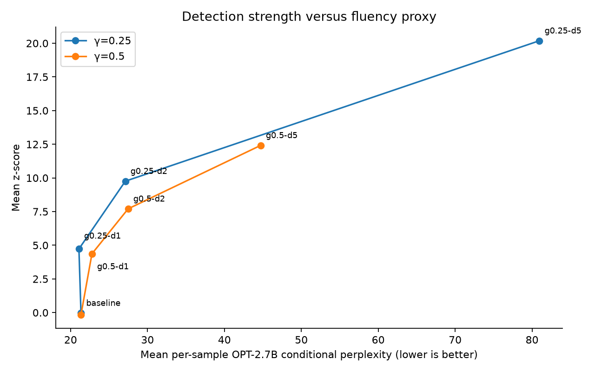
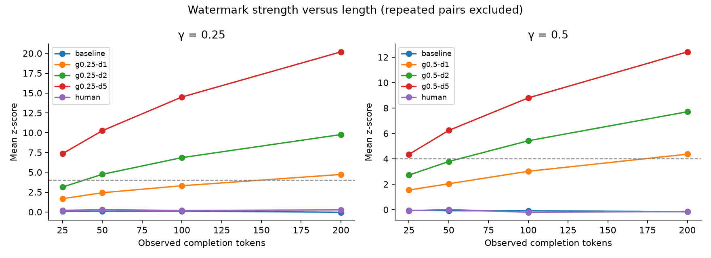
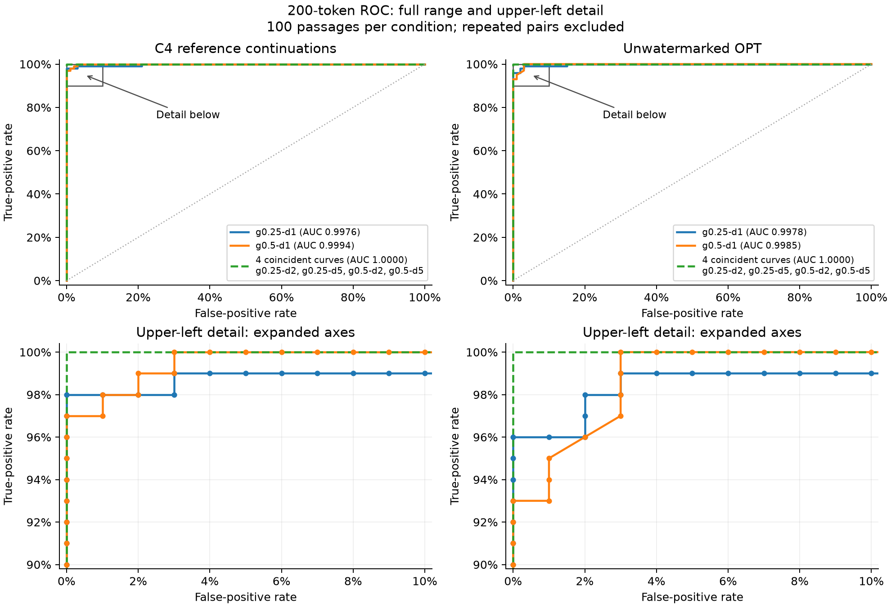
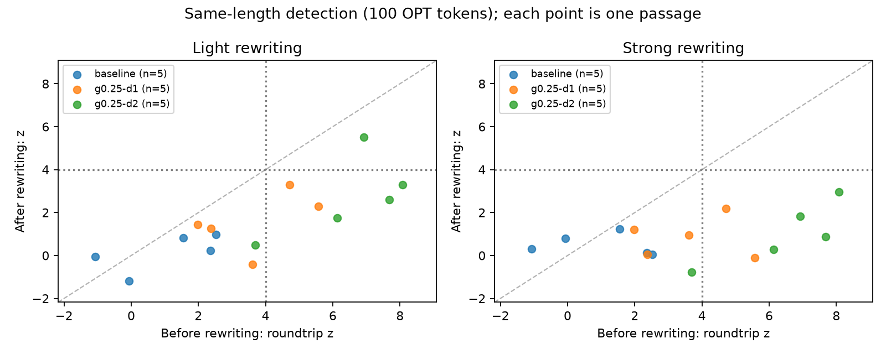

# LLM Watermarking Lab

A smaller replication of [Kirchenbauer et al., *A Watermark for Large Language
Models* (ICML 2023)](https://proceedings.mlr.press/v202/kirchenbauer23a.html),
with exploratory paraphrasing tests and a review of quantization-related work.
The implementation uses Python, PyTorch, and Transformers, with OPT-1.3B
generation and separate OPT-2.7B quality scoring on Apple silicon.

**100 prompts · 700 completions · 800 quality scores · 60 rewriting attempts**

The core experiments reproduce the detection–quality trade-off: stronger
watermarks are easier to detect, while large logit biases increase perplexity.
Rewriting reduces detection in the small attack pilots, but factual changes and
one refusal prevent treating every output as a successful meaning-preserving
attack. Quantization was reviewed as possible future work; no 4-bit/8-bit
experiment or novel-method claim is reported.

## Experiments

| Study | Design | Status |
| --- | --- | --- |
| Core replication | 100 fixed C4 news-like prompts; baseline plus γ ∈ {0.25, 0.5}, δ ∈ {1, 2, 5} | Complete |
| Detection versus length | 25, 50, 100, and 200 observed tokens; ROC/AUC and fixed z thresholds | Complete |
| Conditional quality | OPT-2.7B perplexity; paired bootstrap over prompt groups | Complete |
| Paraphrasing | Two local Qwen rewriters; 30 attempts each on the same 15 source completions | Exploratory |
| Quantization | Prior-art review and proposed controls for a future study | Not experimentally evaluated |

## Relation to the original paper

The replication implements the soft green-list watermark with previous-token
seeding and additive logit bias. Generator and detector share deterministic CPU
partitioning, and correctness is checked against a pinned authors' implementation.
The experimental models, news-like data, parameter sweep, length comparisons,
and independent perplexity oracle follow selected parts of the original study.

This is a trend replication, with 100 prompts rather than the original study's
larger sample. It uses a fixed 128-token prompt and 200-token completion,
multinomial sampling at temperature 1, and no top-k/top-p truncation. EOS is
suppressed uniformly; primary detection deduplicates repeated token pairs.
Sampling, prompt selection, software, hardware, and random-number backends differ
from the historical experiments. Numerical agreement with the original tables is
not expected. [Methods and deviations →](docs/protocol.md)

## Core results

Detection uses **z > 4 at 200 observed tokens**, excluding prompt tokens and
deduplicating repeated pairs. Perplexity is the mean per-passage conditional
perplexity under OPT-2.7B; lower values indicate lower oracle prediction loss.

| Condition | Detected / 100 | Mean perplexity |
| --- | ---: | ---: |
| Unwatermarked OPT | 0 | 21.35 |
| γ=0.25, δ=1 | 72 | 21.08 |
| γ=0.25, δ=2 | 100 | 27.12 |
| γ=0.25, δ=5 | 100 | 80.96 |
| γ=0.5, δ=1 | 62 | 22.77 |
| γ=0.5, δ=2 | 100 | 27.48 |
| γ=0.5, δ=5 | 100 | 44.72 |
| C4 reference continuation | 0 | 11.60 |

Control counts apply separately to each γ. A 100/100 detection count has a 95%
Wilson interval of approximately 96.3–100%; 0/100 flags has an interval extending
to 3.7%. These samples do not establish negligible false-positive rates.
The small perplexity difference at δ=1 is within estimated uncertainty and is
not evidence of better writing. Perplexity does not measure factual accuracy.

### Detection versus quality



Higher bias increases mean detection strength, with a substantial perplexity
cost at δ=5. Each point summarizes 100 completions; perplexity is an oracle-based
fluency proxy, not a factual-accuracy score.

### Detection versus text length

At γ=0.25, δ=2, detection increases from 24/100 at 25 observed tokens to 73/100
at 50, 97/100 at 100, and 100/100 at 200.



Mean z-score rises with observed length for the watermarked conditions, while
the controls remain near zero. Each curve averages 100 passages. The dashed line
marks the per-passage z=4 threshold; a mean above it does not imply every passage
is detected.

### ROC curves



Columns compare against C4 reference continuations and unwatermarked OPT outputs.
The top row retains the full ROC scale; the bottom expands the upper-left corner
to 0–10% false positives and 90–100% true positives. Dots mark measured threshold
points for the two non-ideal curves. Four conditions follow the same ideal ROC
path and are grouped explicitly, without shifting their values for visibility.
AUC uses the full curve. High AUC indicates strong ranking separation in this
sample; 100 controls per comparison give 1-percentage-point false-positive steps
and cannot establish extremely small false-positive rates.

[Full results, ROC curves, and uncertainty →](reports/project_report.md)

## Paraphrasing results

Qwen2.5-1.5B-Instruct and Qwen3-4B-Instruct-2507 rewrite the same saved passages
with light and strong instructions. Watermarking is disabled in both rewriters.
Scoring re-tokenizes text with OPT's tokenizer. Settings and inputs are held fixed
apart from the rewriter checkpoint.

The paired comparison below uses **100 observed OPT tokens** and z > 4.
Only passages long enough in both runs enter each shared denominator.

| Source | Rewrite | Common passages | Clean detections | Qwen2.5 rewrites | Qwen3 rewrites |
| --- | --- | ---: | ---: | ---: | ---: |
| Unwatermarked | Light | 5 | 0 | 0 | 0 |
| Unwatermarked | Strong | 5 | 0 | 0 | 0 |
| γ=0.25, δ=1 | Light | 5 | 2 | 2 | 0 |
| γ=0.25, δ=1 | Strong | 5 | 2 | 1 | 0 |
| γ=0.25, δ=2 | Light | 5 | 4 | 2 | 1 |
| γ=0.25, δ=2 | Strong | 4 | 3 | 1 | 0 |

The final row excludes the smaller model's 49-token refusal from both sides;
the complete archives retain it. The 60 attempts come from five prompt groups,
not 60 independent prompts. Qualitative labels are model-assisted screening,
not independent human validation. Factual changes, omissions, and ambiguous
sources limit conclusions about meaning-preserving watermark removal.



The Qwen3 follow-up compares each passage before and after rewriting at 100 OPT
tokens. Points below the diagonal have lower scores after rewriting; dotted lines
mark z=4. These points include fidelity failures and reuse only five prompt
groups, so they do not establish general meaning-preserving attack success rates.

[Comparison and review notes →](reports/paraphrase-comparison/report.md)

## Quantization: prior work and open question

Quantization durability has already been studied for watermarks embedded in model
weights. Adaptive bias and quality-aware watermark comparisons are also existing
research. The narrower candidate question is whether generator weight precision
changes inference-time KGW's resistance to rewriting after accounting for initial
signal strength and quality cost. Its originality remains unconfirmed.

A credible experiment would require a single model/backend across precisions,
fixed watermark arithmetic and rewriting settings, separate calibration/test
data, and reliable fidelity checks. The current pilots exposed fidelity issues;
the quantization sweep was therefore not undertaken. BF16 inference here is not
presented as a 4-bit/8-bit quantization study.
[Literature review and proposed comparison →](docs/quantization_research_review.md)

## Reproduce

Python 3.12 and [uv](https://docs.astral.sh/uv/) are required.

```sh
uv sync --frozen --extra dev --python 3.12
uv run --frozen --extra dev pytest -q
uv run --frozen watermark-lab evaluate --config reports/main/replay.json
uv run --frozen watermark-lab plot --config reports/main/replay.json
uv run --frozen watermark-lab paraphrase-compare --config configs/paraphrase_comparison.json
uv run --frozen watermark-lab quality-uncertainty --config configs/quality_uncertainty.json
```

Analysis of archived records needs no model download or GPU. Generation requires
the pinned weights and an MPS-capable Mac, or an explicitly configured CPU run.
The local Metal-enabled suite passes 27 tests; CPU environments skip the MPS test.
[Generation, replay, and validation commands →](docs/reproduction.md)

## Repository

| Path | Contents |
| --- | --- |
| `src/watermarking/` | Watermark processor, detector, generation, scoring, and analysis |
| `configs/` | Pinned models/data, experimental settings, and analysis configurations |
| `tests/` | Reference compatibility, statistical checks, pipeline and provenance tests |
| `reports/` | Technical report, raw records, metrics, plots, examples, and replay instructions |
| `docs/` | Methods, reproduction protocol, and quantization review |
| `vendor/lm_watermarking/` | Pinned reference source and its Apache-2.0 license |

The study uses one generation model, one domain, one watermark key, and one
sampling seed per prompt. It does not provide general AI-text classification,
validated low-tail false-positive rates, or a new watermarking algorithm.
