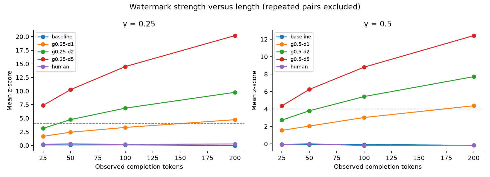
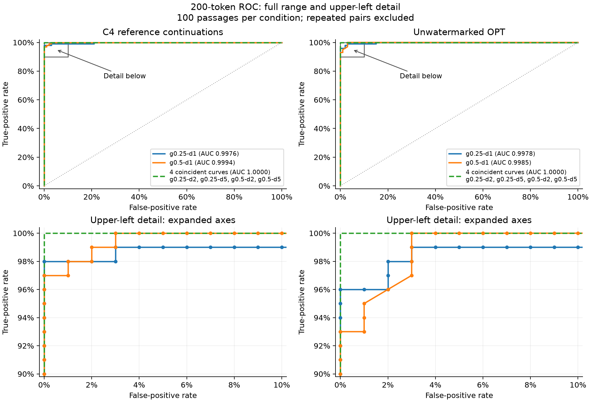
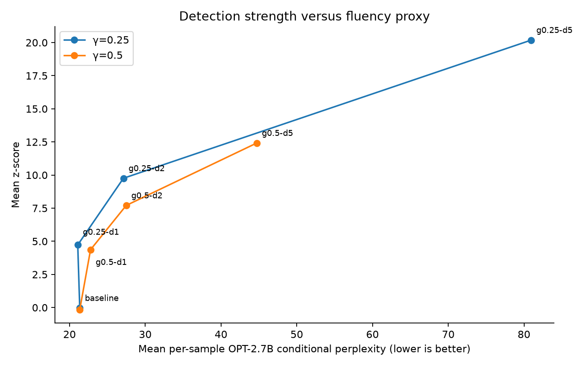

# OPT-1.3B replication results

Measured run: `reports/main`. 100 fixed C4 news-like prompts; 700 generated completions, 200 tokens each.

This is a smaller replication of experimental trends, not the original numerical results.

## Detection at 200 observed tokens

Primary scoring ignores repeated token pairs, omits the first completion token, and excludes all prompt tokens. Thus 200 observed tokens provide at most 199 scored pairs.

| γ | Condition | n | Mean z | Rate z > 4 (95% Wilson interval) | AUC vs human |
|---|---|---:|---:|---|---:|
| 0.25 | baseline | 100 | -0.04 | 0.0% (0.0%–3.7%) | — |
| 0.25 | g0.25-d1 | 100 | 4.73 | 72.0% (62.5%–79.9%) | 0.998 |
| 0.25 | g0.25-d2 | 100 | 9.76 | 100.0% (96.3%–100.0%) | 1.000 |
| 0.25 | g0.25-d5 | 100 | 20.19 | 100.0% (96.3%–100.0%) | 1.000 |
| 0.25 | human | 100 | 0.26 | 0.0% (0.0%–3.7%) | — |
| 0.5 | baseline | 100 | -0.16 | 0.0% (0.0%–3.7%) | — |
| 0.5 | g0.5-d1 | 100 | 4.37 | 62.0% (52.2%–70.9%) | 0.999 |
| 0.5 | g0.5-d2 | 100 | 7.71 | 100.0% (96.3%–100.0%) | 1.000 |
| 0.5 | g0.5-d5 | 100 | 12.42 | 100.0% (96.3%–100.0%) | 1.000 |
| 0.5 | human | 100 | -0.15 | 0.0% (0.0%–3.7%) | — |

Rates for controls are false-positive rates; rates for watermarked conditions are detection rates. Intervals describe sampling uncertainty; they do not correct domain, key, or model selection effects.

## Generation performance

Mean per-completion throughput: 33.7 tokens/s. Timing includes processor overhead and synchronization, excludes model download/loading. The first completion includes warm-up overhead.
Largest sampled MPS driver allocation: 3.14 GiB. This is a between-completion sample, not total process memory or peak memory.

## Conditional perplexity

OPT-2.7B scores only completion tokens conditioned on the saved prompt. Perplexity is a fluency proxy, not a factuality or human-preference measure.

| Condition | n | Mean per-sample perplexity | Pooled perplexity |
|---|---:|---:|---:|
| baseline | 100 | 21.35 | 18.40 |
| g0.25-d1 | 100 | 21.08 | 18.72 |
| g0.25-d2 | 100 | 27.12 | 23.79 |
| g0.25-d5 | 100 | 80.96 | 63.52 |
| human | 100 | 11.60 | 10.45 |
| g0.5-d1 | 100 | 22.77 | 20.20 |
| g0.5-d2 | 100 | 27.48 | 24.36 |
| g0.5-d5 | 100 | 44.72 | 41.16 |

## Protocol and limits

- Model and dataset revisions, environment, and prompt hash: `run.json`.
- Full generation settings and vocabulary dimensions: `generation_settings.json`.
- All eligible-pair and deduplicated scores: `detections.jsonl`; summaries: `metrics.csv`.
- Fixed 128-token prefixes from the first 100 eligible distinct validation documents; not a random sample of the complete C4 distribution.
- EOS is suppressed for all conditions; this differs from the original multinomial sample-selection protocol. Repetitive tails remain in the analysis.
- CPU PRNG partitions match the pinned reference on CPU, not its GPU PRNG streams.
- OPT has padded output logits beyond the tokenizer vocabulary. These are suppressed in all conditions; the watermark partitions the actual tokenizer vocabulary.
- Detector uses nominal γ for the reference-compatible z-score; effective γ is saved.
- Gaussian p-values are approximate and assume a suitable null; they are not empirically established false-positive rates or authorship probabilities.
- One key and one sampling seed per prompt; no tiny false-positive-rate claim is supported.
- Beam search, attacks, TriviaQA, Qwen, and research extensions are deferred.

## Figures

