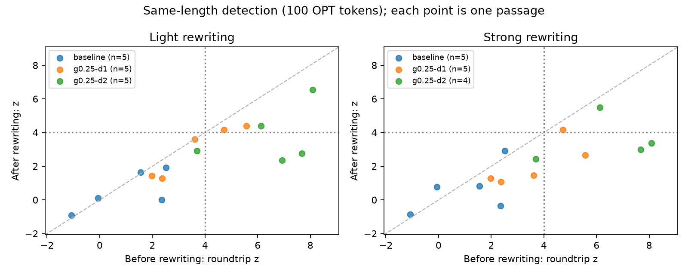

# What the first paraphrasing pilot tells us

The pipeline works: 30 Qwen rewrites of 15 saved OPT completions were generated,
scored, and archived. It also uncovered problems with rewrite fidelity. These
outputs support a feasibility check, not a claim about resistance to
meaning-preserving paraphrasing or quantization.

## Detection at the same length

At 100 observed OPT tokens, with repeated-pair deduplication and z > 4:

| Generation condition | Rewriting | Eligible passages | Clean detections | Rewritten detections |
| --- | --- | ---: | ---: | ---: |
| Unwatermarked | Light | 5/5 | 0/5 | 0/5 |
| Unwatermarked | Strong | 5/5 | 0/5 | 0/5 |
| γ=0.25, δ=1 | Light | 5/5 | 2/5 | 2/5 |
| γ=0.25, δ=1 | Strong | 5/5 | 2/5 | 1/5 |
| γ=0.25, δ=2 | Light | 5/5 | 4/5 | 2/5 |
| γ=0.25, δ=2 | Strong | 4/5 | 3/4 | 1/4 |

The last row excludes one 49-token refusal from the 100-token measurement, with
its exclusion explicitly counted. Its clean count uses the same four passages.
It must not be called a successful paraphrasing attack. All 30 outputs remain in
the archive, regardless of fidelity or detection score.

The light δ=2 mean z fell from 6.50 to 3.79 at this length. For δ=1 it fell from
3.65 to 2.98. These are averages across five passages, not precise population
estimates. The five prompts are reused across conditions, so the 30 rewrites are
not 30 independent prompt samples. No small false-positive rate is established.

Each point compares the same passage before and after editing. Points below the
dashed diagonal have weaker detection scores after editing. The dotted horizontal
line marks z=4 after rewriting. These points include fidelity failures, so they
describe the pipeline outputs rather than a validated attack benchmark.

## The quality check changes the interpretation

All 30 outputs received provisional qualitative inspection; the notes are in
[manual_review.csv](manual_review.csv), with the reviewer identified. This is not
an independent human study or a validated semantic-quality metric. Labels assess
faithfulness to the generated source, not whether the source claims are true.
Several original OPT passages are already garbled or factually unreliable.

Concrete issues include:

- Both rewrites of `c4-validation-0 / baseline` replace separate shipping charges
  with shipping included in the quoted price.
- `c4-validation-4 / baseline / strong` finishes an incomplete dietary
  qualification with “other processed meats,” information absent from the input.
- `c4-validation-4 / g0.25-d2 / strong` is a refusal, not a paraphrase.
- `c4-validation-6 / g0.25-d1 / strong` changes “sometimes two years” to “several
  years.”
- `c4-validation-6 / g0.25-d2 / light` completes an unfinished Mandela-era clause
  with a new claim about peace, unity, and reconciliation.

Read [examples.md](examples.md) for every source/output pair. The stronger
instruction reduced average retained token pairs in each generation condition,
but less lexical overlap does not prove equivalent meaning or a better attack.

## Checks and practical observations

- All 15 original passages re-tokenized to exactly their saved OPT token IDs.
  The roundtrip control did not change scores in this pilot.
- Rewrites ranged from 49 to 212 OPT tokens. Only five of the 30 reached 200 OPT
  tokens, making 100 tokens more useful for this initial comparison. Shorter
  output remains a possible source of selection effects even at fixed lengths.
- All 30 ended with a normal Qwen EOS marker; none hit the 512-Qwen-token cap.
- Summed generation time was 181.24 seconds, excluding loading and scoring.
  Maximum sampled MPS driver allocation was 3.12 GiB, not total or peak RAM.
- FP16 Qwen inference failed before producing any saved rewrite. The completed
  run used the checkpoint's native BF16 format; the failed manifest is retained.
- Tests passed with Metal access: 23 passed. Resuming the completed real run
  verified all 30 records without loading a model.

## Scope

These results describe an exploratory rewriting pilot. The larger-rewriter
follow-up is reported [separately](../paraphrase-qwen3-pilot/interpretation.md);
neither pilot establishes general meaning-preserving attack success rates.
