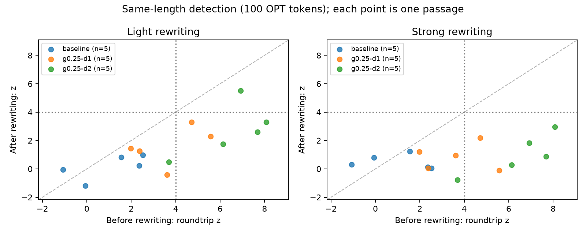

# Larger-rewriter follow-up: findings and limits

The fixed follow-up generated 30 outputs with Qwen3-4B-Instruct-2507. It avoided
the refusal seen in the smaller-model pilot, but still changed or interpreted
source claims. This does not establish a reliable meaning-preserving attack
benchmark or a new research contribution.

## Same inputs and scoring

The input passages, rewrite instructions, seeds, BF16 format, sampling settings,
output budget, detector, and observation lengths match the first pilot. Only the
rewriter checkpoint/revision and output directory differ. Both models run through
the same PyTorch/Transformers pipeline on MPS, without a watermark processor in
the rewriter. Different architectures and training prevent attribution to model
size alone. The [protocol](../../docs/paraphrase_followup_protocol.md) was committed
before generating these outputs.

At 100 observed OPT tokens, using repeated-pair deduplication and z > 4:

| Source condition | Rewrite | Eligible | Clean hits | Rewritten hits |
| --- | --- | ---: | ---: | ---: |
| Unwatermarked | Light | 5/5 | 0/5 | 0/5 |
| Unwatermarked | Strong | 5/5 | 0/5 | 0/5 |
| γ=0.25, δ=1 | Light | 5/5 | 2/5 | 0/5 |
| γ=0.25, δ=1 | Strong | 5/5 | 2/5 | 0/5 |
| γ=0.25, δ=2 | Light | 5/5 | 4/5 | 1/5 |
| γ=0.25, δ=2 | Strong | 5/5 | 4/5 | 0/5 |

For δ=2, mean z at this length fell from 6.50 to 2.73 under the light instruction
and to 1.03 under the strong instruction. These are descriptive results from
five prompt groups. All outputs, including fidelity failures, are included. The
strong-row denominator differs from the first pilot, where one refusal was too
short. [The paired comparison](../paraphrase-comparison/report.md) uses the common
eligible passages and therefore reports 3/4 clean versus 0/4 rewritten for that
shared δ=2 strong subset.

## Fidelity prevents a broader attack claim

All outputs were inspected without displaying their follow-up detector scores.
The [text-only packet](review_packet.md) preserves the source/rewrite pairs;
[manual_review.csv](manual_review.csv) records the provisional judgments and
reviewer. The reviewer recognized earlier inputs, so this was not a blinded or
independent human study. Labels are diagnostic notes, not a validated metric.

Examples include:

- Both rewrites of the first baseline keep the separate $2,099 price and $1,679
  shipping figure, avoiding a specific first-pilot error. Other ambiguities in
  the fragmentary source remain.
- Both rewrites of `c4-validation-0 / g0.25-d1` turn an incomplete “month” opening
  into “each month,” adding recurrence. The strong rewrite also supplies an
  expansion of EOC absent from the source.
- `c4-validation-2 / g0.25-d2 / light` replaces the source's “local, state, or
  local” with “local, state, or federal.” Repairing an apparent mistake changes
  what the input says.
- `c4-validation-4 / baseline / strong` changes experts not being surprised into
  experts being unconvinced. Those attitudes are different.
- `c4-validation-7 / g0.25-d2 / strong` changes the debt phrase to a balanced-budget
  debt increase and completes the unfinished extension fragment with a new claim.

There were five `no_clear_change`, seventeen `changed_or_omitted`, eight
`unclear_source`, and zero `refusal` labels. The first pilot also had five
`no_clear_change` labels. These counts do not certify equivalence or establish
model superiority. Some sources are already incoherent or factually unreliable;
the review assesses their preservation, not their truth. No case was regenerated
or removed from the numerical results to improve an outcome.

## Practical checks and outcome

- All 15 source passages re-tokenized to their original OPT IDs exactly.
- All 30 rewrites reached 100 OPT tokens; 18 reached 200. Lengths were 183–228.
- All 30 ended with normal EOS; none hit the 512-Qwen-token output cap.
- Summed generation time was 494.99 seconds, excluding loading and scoring.
  Maximum sampled MPS driver allocation was 7.89 GiB, not peak or total system RAM.
- Completed-run resume verified all 30 records without loading a model. Archived
  numerical reports and plots can be replayed offline.

The larger model produced lower detection scores in this sample and avoided one
type of failure, while fidelity problems remained. The results remain exploratory. Weight quantization was not evaluated.
